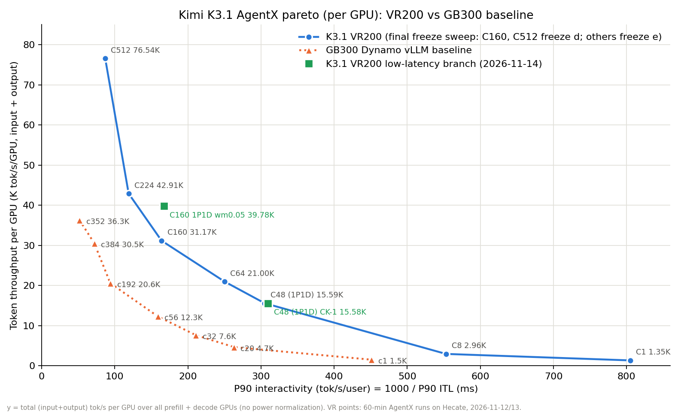

# K3.1 VR200 AgentX results (Hecate, 2026-11-12/13)

## Pareto: VR200 final freeze sweep vs GB300 baseline

Per all-in utility MW:

Per GPU (no power normalization):

- y = total (input + output) tok/s per GPU x 1e6 / all-in utility W per GPU (VR200 3.3 kW, GB300 2.12 kW);
  x = P90 interactivity = 1000 / P90 ITL (ms). The per-GPU plot uses the same total tok/s per GPU without the power
  factor (GB300 per-GPU values = M tok/s/MW x 2.12 kW). Data: `pareto_points.csv`; plots: `pareto_plot.py`.
- VR200 points: official 60-min AgentX runs (live_metrics.py, profiling phase), each in its own `k31vr-<point>-*` directory below:
  C1, C8, C48 (1P1D), C64, C224 on freeze e (`k31vr-freeze-20261113e`); C160 and C512 on freeze d (0f558a4414).
  C224 replaces C256: at C256 the trace's ~5 min burst fills decode KV and collapses decode throughput (root cause:
  decode preemption + local recompute; see the decode burst investigation), C224 does not hit it.
- GB300 baseline: Dynamo vLLM GB300 points as used throughout the VR campaign (M tok/s/MW at 2.12 kW).

| VR200 point | tok/s/GPU | interactivity | M tok/s/MW | gsm8k (strict) |
|---|---|---|---|---|
| C1 | 1,347 | 805 | 0.41 | 0.965 |
| C8 | 2,960 | 553 | 0.90 | 0.969 |
| C48 (1P1D) | 15,593 | 305 | 4.73 | 0.973 |
| C64 | 21,002 | 250 | 6.36 | 0.974 |
| C160 | 31,174 | 164 | 9.45 | 0.974 |
| C224 | 42,908 | 119 | 13.00 | 0.967 |
| C512 | 76,544 | 87 | 23.20 | 0.968 |

## Low-latency branch results (2026-11-14, `wzhao/k31-vr-ll-integ` dea4ebd06f)

Green squares in the plots.

| Point | GPUs | tok/s/GPU | interactivity | M tok/s/MW | gsm8k (strict) | vs official |
|---|---|---|---|---|---|---|
| C160 on 1P1D + decode watermark 0.05 | 24 | 39,782 | 167.1 | 12.06 | 0.966 | **+27.6% y**, +1.9% x vs C160 2P1D (31,174 @ 164) |
| C48 1P1D checkpoint CK-1 | 24 | 15,580 | 309.6 | 4.72 | 0.968 | flat y, +1.5% x vs 15,593 @ 305 (projection missed; root cause in its README) |

Details: `k31vr-c160-1p1d-wm05-llinteg-20261114/`, `k31vr-c48-1p1d-ck1-llinteg-20261114/`; config `srt-configs/c160-1p1d-wm05.yaml`.

## Current code frontier (2026-11-22, int64.2 / f19 `15c281dc32`)

`k31vr-int64-frontier-20261122/`: the 8-node record points on the current code: P DEP16 + D DP4 x (TP4+DCP4) EP16,
32 GPUs, gsm8k strict 0.9795 on the same build. It has a 4-way pareto (per GPU and per MW) against the
2026-11-17 release-draft sweep and the InferenceX VR200 dynamo-sglang baseline (2026-11-20).

| point | full profiling: tok/s/GPU @ P90 intvty | minutes 10-60: tok/s/GPU @ P90 intvty |
|---|---|---|
| c608-f19 | 107,447 @ 128.2 | 113,087 @ 133.7 |
| c576-f19 | 101,937 @ 134.3 | 107,208 @ 136.9 |

InferenceX's per-point mean input differs from our ~149K trace (315K at c1, 135-150K at c156-c720). Details and caveats
are in its README.
