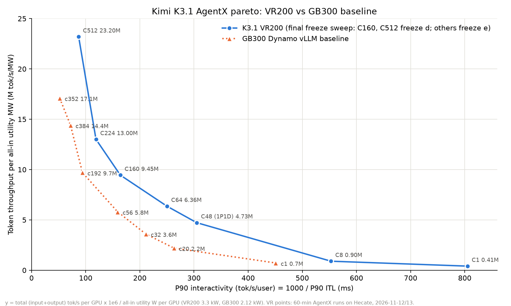

# K3.1 VR200 AgentX results (Hecate, 2026-11-12/13)

## Pareto: VR200 final freeze sweep vs GB300 baseline

- y = total (input + output) tok/s per GPU x 1e6 / all-in utility W per GPU (VR200 3.3 kW, GB300 2.12 kW);
  x = P90 interactivity = 1000 / P90 ITL (ms). Data: `pareto_points.csv`; plot: `pareto_plot.py`.
- VR200 points: official 60-min AgentX runs (live_metrics.py, profiling phase), each in its own `k31vr-<point>-*` directory below:
  C1, C8, C48 (1P1D), C64, C224 on freeze e (`k31vr-freeze-20261113e`); C160 and C512 on freeze d (0f558a4414).
  C224 replaces C256: at C256 the trace's ~5 min burst fills decode KV and collapses decode throughput (root cause:
  decode preemption + local recompute; see the decode burst investigation), C224 does not hit it.
- GB300 baseline: Dynamo vLLM GB300 points as used throughout the VR campaign (M tok/s/MW at 2.12 kW).

| VR200 point | tok/s/GPU | interactivity | M tok/s/MW | gsm8k (strict) |
|---|---|---|---|---|
| C1 | 1,347 | 805 | 0.41 | 0.965 |
| C8 | 2,960 | 553 | 0.90 | 0.969 |
| C48 (1P1D) | 15,593 | 305 | 4.73 | 0.973 |
| C64 | 21,002 | 250 | 6.36 | pending |
| C160 | 31,174 | 164 | 9.45 | 0.974 |
| C224 | 42,908 | 119 | 13.00 | pending (2P1D gsm8k on freeze e queued) |
| C512 | 76,544 | 87 | 23.20 | 0.968 |
