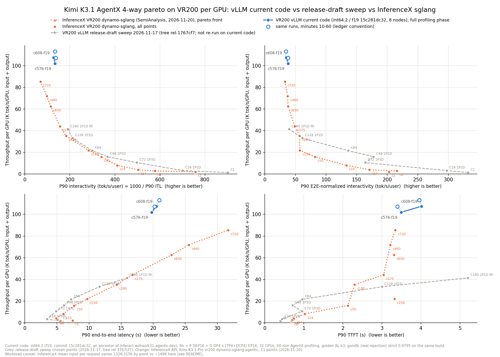
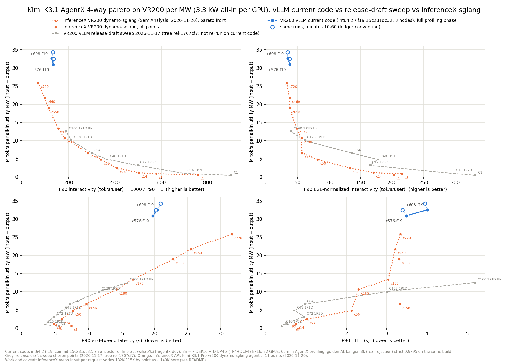

# K3.1 VR200 AgentX: current code (int64.2 / f19) 8-node frontier vs InferenceX VR200 sglang (2026-11-22)

This directory holds the two AgentX runs that represent the current code: build int64.2 (f19), 8 nodes, one P/D
topology, CONC 576 and 608. It plots them against two references:

- the 2026-11-17 release-draft sweep (`../k31vr-release-draft-sweep-20261117`, chosen points, tree `rel-1767cf7`), which
  covers low and mid latency. Those points were **not** re-run on the current code; they are grey in the plots and
  labelled with their tree;
- the latest InferenceX VR200 dynamo-sglang Kimi-K3.1 agentic baseline (SemiAnalysis, curve date 2026-11-20), with its
  pareto front.

## Code and setup (both points)

- **Build:** int64.2 = "f19", overlay `g-15c281dc32`.
  - Commit `15c281dc32` is int64 (`b5ceb707a7`) plus the two last-token staging race fixes: `7c58607b8c` (SparseMlaPrefillH8)
    and `55e0dac215` (SparseMlaDecodeTS).
  - It was pushed as `wzhao18/vllm` `wzhao/k31ws-int642-cand`. It is an ancestor of Inferact `wzhao/k31-agentx-dev`.
  - The branch head (int64.4, `a501b7f0`) adds KdaFlow-24, PBIND (a) and iterlog changes. **These runs do not include them.**
- **Model:** NVFP4 real weights `1d820323` (served name `moonshotai/Kimi-K3`) and the release DSpark drafter `e4e6e626`.
  Speculative decoding uses k=3 with synthetic acceptance at the release golden AL 3.08. KV cache is fp8.
- **Container:** `k31ws/img:kimi-k31-wzhao-nov-11`, dynamo 1.6.1+k31, frontend `dynbl-e65a5f734`.
- **Topology:** 8 nodes (32 GPUs, 4 per node, Hecate VR200 NVL72), 1P1D.
  - P: DEP16 (TP1 x DP16, EP16), 4 nodes.
  - D: DP4 x (TP4+DCP4), EP16, 4 nodes.
  - Decode max-num-seqs is 160 per rank (640 rows). Time at the decode cap was 0.00% in both runs.
- **AgentX:** 60-minute profiling phase. 0 real errors in both runs (12 and 14 expected-empty responses).
  NIXL: 0 failed transfers.

| point | AgentX run (Hecate `k31vr/e2e/outputs/`) | time (PST) |
|---|---|---|
| c608-f19 | `a1242885-agx-x8-k3-c608-f19-1122104139` | 2026-11-22 10:41-12:16 |
| c576-f19 | `a1242885-agx-x8-k3-c576-f19-1122085528` | 2026-11-22 08:55-10:28 |

## Metrics (both conventions)

- **Full profiling phase** (`metrics.json`, `frz_metrics.py`, unchanged from the earlier sweeps).
  - This is the convention of the other `results/` sweeps and of the plots' filled blue markers.
  - It matches the official `process_agentic_result` regen with 32 GPUs: c608 107,447, c576 101.94K
    (`agentx/logs/agentic/OFFICIAL_*.json`).
- **Minutes 10-60** (`metrics_win10_60.json`, `win_metrics.py`). This is the campaign ledger's convention, plotted as
  hollow blue markers. Two windowings are recorded:
  - `end` = eval/ATTRIBUTION.md §0: ok records whose request **ends** in profiling minutes 10-60, y = tokens / 3,000 s / 32.
    The table uses this one.
  - `start` = E2E12 `winwin.py`: records that **start** in minutes 10-60.

<!-- POINTS -->
| point | window | n ok | TPS/GPU | P90 intvty | P90 E2E-norm | P90 E2E (s) | P90 TTFT (s) | P50 TTFT (s) | client hit |
|---|---|---|---|---|---|---|---|---|---|
| c576-f19 | full profiling (60.5 min) | 82,486 | 101,937 | 134.3 | 38.1 | 19.8 | 3.50 | 1.80 | |
| c576-f19 | minutes 10-60 (by end) | 68,687 | 107,208 | 136.9 | 38.0 | 20.2 | 3.39 | 1.83 | 96.00% |
| c608-f19 | full profiling (60.5 min) | 86,606 | 107,447 | 128.2 | 34.7 | 20.5 | 4.01 | 2.01 | |
| c608-f19 | minutes 10-60 (by end) | 72,168 | 113,087 | 133.7 | 34.3 | 21.0 | 3.96 | 2.07 | 95.86% |
<!-- /POINTS -->

- **Ledger cross-check.** The `start` window reproduces the E2E12 posts exactly: c608 113,106 @ 133.7 and c576 107,187 @ 136.9.
  The `end` window gives 113,087 (ATTRIBUTION's "113.09K") and 107,208.
- **Why full-phase y is about 5% lower.** It includes profiling minutes 0-10, which the ledger window drops as ramp-up,
  and divides by the full ~60.5 min span (including the drain).
- **Interactivity.** x is 2.6 (c576) and 5.5 (c608) lower over the full phase than in minutes 10-60.
- **Per MW:** divide TPS/GPU by 3.3 kW. c608 = 32.6 (full) / 34.3 (10-60) M tok/s per MW.

## gsm8k (accuracy anchor of the build)

Both points use the same real-rejection gsm8k twin. It ran on the **same build and topology**, but on Rhea, not on
Hecate's AgentX allocation:

- Run: `rhea:.../outputs/a110790-agx-r8-k3-c512-f19-ev-1122082418` (Rhea VR200 NVL72, 8 nodes `rhea[0019-0022,0024-0027]`).
- Build: overlay `g-15c281dc32` on 8/8 configs (as-run PASS).
- Topology: P DEP16 + D DP4 x (TP4+DCP4) EP16, k3.
- Settings: `rejection_sample_method=block` (real rejection), FlashInfer autotune off on P and D, EVAL_CONC 256.
- Result: **strict 0.9795**, flexible 0.9788. Real AL 3.264 at k3, from the decode SpecDecoding counters (249,434 accepted /
  330,504 drafted).
- NIXL: 92 failed transfers out of 5,322 (1.7%, recompute policy), 0 handshake failures. Accuracy was unaffected.
- The same logs are copied under each run's `gsm8k/`. Git stores identical files once, so the copy adds no size.

## Baseline: InferenceX VR200 dynamo-sglang (`vr200_sglang_infx.json`)

- **Source:** SemiAnalysis InferenceX API `https://inferencex.semianalysis.com/api/v1/benchmarks?model=Kimi-K3.1-Pro`,
  `hardware=vr200`, `framework=dynamo-sglang`, agentic traces, fetched 2026-11-22.
- **Points:** 11, all dated 2026-11-20 (c1-c720), with the same 4 metric keys as ours.
- **y:** InferenceX's total tok/s per GPU. Per MW uses the same 3.3 kW all-in per VR200 GPU.

**Workload caveat: the workloads only partly match.** Mean input tokens per request (`mean_input_tokens`) vary by point:

| InferenceX point | c1 | c8 | c14 | c24 | c50 | c156 | c175 | c180 | c460 | c650 | c720 |
|---|---|---|---|---|---|---|---|---|---|---|---|
| mean input (K tokens) | **315.4** | 169.2 | 131.7 | 172.3 | 158.0 | 149.0 | 148.4 | 149.9 | 134.8 | 139.7 | 135.6 |

- **Our trace:** about 149K input / 1.04K output per request (c608 149.4K, c576 148.8K, minutes 10-60).
- **Low concurrency (c1-c50) does not match.** InferenceX's mean input ranges 132K-315K (-12% to +111% vs ours), so those
  points are not like-for-like. The c1 point at 315K is 2.1x ours; c8 and c24 are about 15% heavier.
- **Mid range (c156-c180) matches** (148-150K).
- **Throughput end (c460-c720) is about 6-10% lighter** than ours (135-140K vs 149K).
- **Hit rate and trace version are not in the API rows,** so prefix-cache behaviour cannot be compared.
- **Overall:** the closest comparison to our 8n points is InferenceX c460/c650/c720, at slightly shorter inputs.

## Plots

- **Blue:** current code. Filled markers are the full profiling phase; hollow markers are minutes 10-60, joined by a thin line.
- **Grey:** release-draft sweep chosen points, tree `rel-1767cf7`. This is the low/mid-latency reference.
- **Orange:** InferenceX dynamo-sglang. The dotted line is its pareto front.
- **Panels:** y = throughput per GPU against P90 interactivity, P90 E2E-normalized interactivity, P90 E2E latency and
  P90 TTFT.
- **c608 vs InferenceX:**
  - Full phase: 107.4K @ x 128 vs InferenceX c720 85.4K @ x 69 and c460 71.8K @ x 98.
  - The current code is above the InferenceX front at the high-throughput end, at higher interactivity.
  - P90 TTFT is higher (4.0 s vs 3.2-3.3 s), and the input-length caveat above applies.

## Files

- `runs/<label>-a<job>/`: one point.
  - `agentx/`: logs and config. Excluded: dloan/otel dumps, timeslices, files over 20 MB (`profile_export.jsonl`,
    prefill/frontend logs), `aiperf-runtime/` (the client venv) and `logs/iterlog/` (~90 MB of per-iteration logs, kept on Hecate).
  - `gsm8k/`: the gsm8k twin's logs, plus `score.json`.
  - `metrics.json` (full phase), `metrics_win10_60.json` (minutes 10-60) and `meta.json` (build, ledger numbers, validity).
- `collect.sh`: copies one point and computes the metrics. It is the release-draft `collect.sh` with a gsm8k host
  argument, the 10-60 window, two extra excludes and `rsync -rlt`.
- `frz_metrics.py` (unchanged), `win_metrics.py`, `update_points.py` (builds `points.json` and the table above),
  `plot_pareto4.py`, `vr200_sglang_infx.json`.
