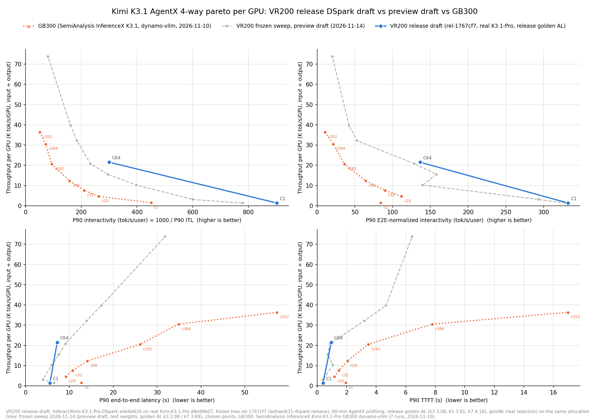
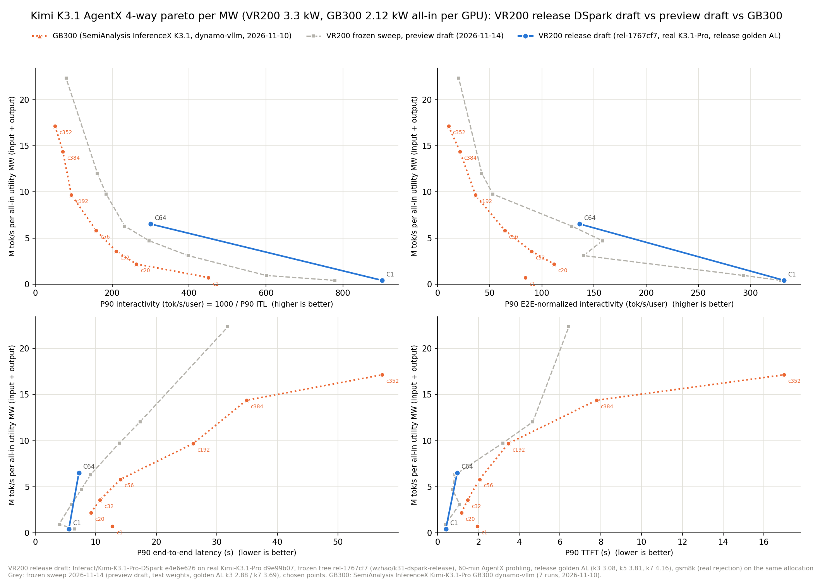

# K3.1 VR200 AgentX sweep: release DSpark draft on the real K3.1-Pro weights (2026-11-17)

This sweep reruns the 8 chosen points of the frozen VR200 sweep (`../k31vr-frozen-sweep-20261114`) with two changes, so the
comparison isolates them:

- **Draft model.** The released draft `Inferact/Kimi-K3.1-Pro-DSpark @ e4e6e626` (GQA, sliding window 2048) replaces the
  preview draft. It runs on the optimized specialized-decode path in branch `wzhao/k31-dspark-release`.
- **Acceptance length.** AgentX uses the release golden table: k7 4.16, k5 3.81, k3 3.08 (the preview table was k7 3.69).
- **Target weights.** The real `moonshotai/Kimi-K3.1-Pro @ d9e99b07` replaces the rainhollow test weights.

Everything else is the frozen sweep's render: topology, concurrency, precision and AgentX client. The configs are in
`../chosen_configs_nov_15/release_draft/` (`configs/` + `k5/configs/`).

- **Code:** frozen tree `rel-1767cf7`, i.e. commit 1767cf7 of `wzhao/k31-dspark-release`. Prefill and decode both run it
  (PYTHONPATH of both roles).
- **AgentX:** 60-minute profiling phase and synthetic acceptance at the golden AL, as in the frozen sweep.
- **gsm8k:** the twin of each AgentX run uses real rejection sampling, on the same hold. Its decode logs give the real AL.

## Release vs preview draft

<!-- CMP -->
| point | TPS/GPU (preview -> release) | P90 intvty (preview -> release) | P90 TTFT s (preview -> release) | gsm8k strict | real AL (k) |
|---|---|---|---|---|---|
| C1 | 1,342 -> 1,359 (+1.2%) | 778.6 -> 901.4 (+15.8%) | 0.36 -> 0.40 | 0.9659 -> pending | - (-) |
| C64 | 20,778 -> 21,527 (+3.6%) | 232.8 -> 300.0 (+28.9%) | 0.85 -> 0.96 | 0.9689 -> pending | - (-) |
<!-- /CMP -->

## Points

<!-- POINTS -->
| point | topology (GPUs) | AgentX run | TPS/GPU | P90 intvty | P90 E2E-norm | P90 E2E (s) | P90 TTFT (s) | gsm8k strict | chosen | note |
|---|---|---|---|---|---|---|---|---|---|---|
| C1 | 1P1D: P TP8+DCP8, D TP16+DCP16 (24) | C1-a1118776 | 1,359 | 901.4 | 332.2 | 5.6 | 0.40 | pending | **yes** |  |
| C64 | 1P1D: P TP8+DCP8, D TP16+DCP16 (24) | C64-a1118777 | 21,527 | 300.0 | 136.3 | 7.2 | 0.96 | pending | **yes** |  |
<!-- /POINTS -->

## Incidents

- **C512, first attempt (tree `rel-fa43a52`).** A decode engine died about 37 minutes in, during AgentX warmup:
  `AssertionError` in `KVCacheManager.truncate_computed_blocks`.
  - Cause: NIXL's divergent local-hit lookup let only Mamba groups lag the full-attention hit. The release draft's
    slot-packed sliding-window group caches window tails only at state boundaries, so it lagged too. The scheduler's
    partial-tail truncation then overran its block list.
  - Fix: commit 1767cf7. A non-Mamba group that lags the full-attention hit now falls back to the reconciled lookup.
    Two unit tests were added; the core tests show the same 24 failures as the previous tree.
  - Sweep reset: every point reruns on `rel-1767cf7`. That includes C1, whose first launch (07:34) used the old tree
    and was stopped after 37 minutes.
  - The C512 gsm8k twin on the old tree scored strict 0.9803 with real AL 3.25 at k3. It is not counted.

## Files

- `runs/<label>-a<job>/`: one point. Contents:
  - `agentx/`: logs and config.
  - `gsm8k/`: logs and config, plus `score.json` (strict, flexible, real AL).
  - `metrics.json` and `meta.json`.
- `collect.sh`: copies one point from Hecate and computes `metrics.json` (with `frz_metrics.py`, unchanged from the
  frozen sweep) and `gsm8k/score.json`.
- `update_points.py`: rebuilds `points.json`, the two tables above and the plots.
- `plot_pareto4.py`: the frozen sweep's plot, adding the frozen preview-draft points as a grey dashed series.
